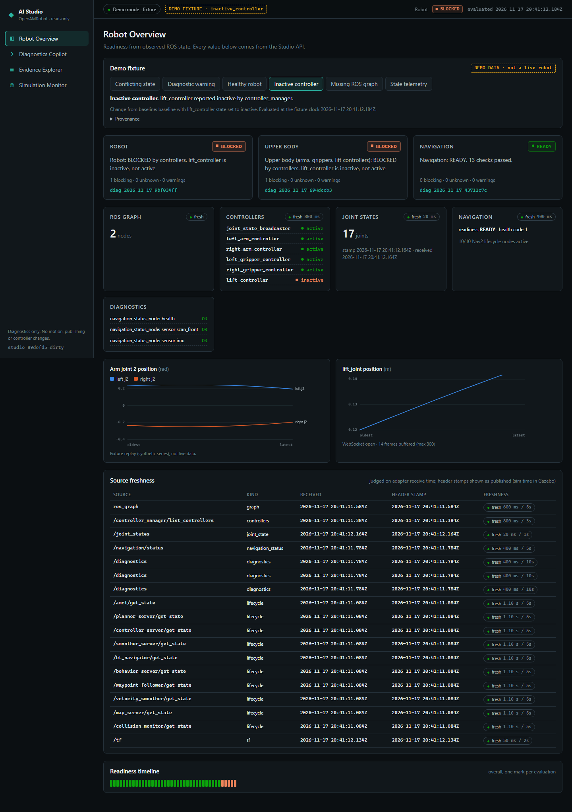
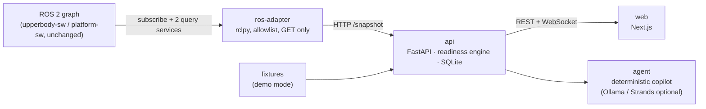

# OpenAMRobot AI Studio

Read-only, evidence-backed diagnostics for the [OpenAMRobot](https://github.com/openAMRobot) ROS 2 Jazzy
digital twin. It answers *"why is the robot not ready?"* from observed ROS state, and says UNKNOWN when
the evidence is missing, stale or contradictory.

This is an independent contributor prototype of milestone M1 in the *OpenAMRobot AI Software Extension*
RFC. It is not an official OpenAMRobot repository. It changes no upstream controller, launch file or
safety component, and it is not a safety function or physical acceptance.



## What it does

| View | What you get |
|---|---|
| **Robot Overview** | Readiness per subsystem (READY, BLOCKED, UNKNOWN or ERROR), controller states, joint-state, navigation and diagnostic health, source freshness, telemetry charts, and a fixture switcher in demo mode |
| **AI Diagnostics Copilot** | Natural-language questions answered by deterministic tools. Each line cites the source, receive time, age and trace id. Requests to act are refused before any tool runs |
| **Evidence Explorer** | Recorded evaluations (with their full snapshot), events and copilot tool calls, filterable by task, status, subsystem, severity and time |
| **Simulation Monitor** | Joint states, TF frames, controllers and a lift-height schematic, labelled as telemetry-based, not a Gazebo render |



More detail: [architecture](docs/architecture.md) · [discovery of the real interfaces](docs/discovery.md) ·
[ROS integration](docs/ros-integration.md) · [demo script](docs/demo-script.md) · [plan](docs/plan.md)

## Quick start (demo mode: no ROS, no model)

Needs Python 3.11+ and Node 20+.

```powershell
# Windows
.\scripts\setup.ps1
.\scripts\dev.ps1           # API on :8000 (docs at /docs), web on :3000
```

```bash
# Linux / macOS
./scripts/setup.sh
./scripts/dev.sh
```

Open http://localhost:3000. Demo data comes from six labelled fixtures, and the UI marks it as DEMO FIXTURE on every page:
- `healthy`
- `inactive_controller`
- `stale_telemetry`
- `missing_graph`
- `conflicting_state`
- `diagnostic_warning`

## Live mode (real ROS 2 graph)

```bash
# On the ROS 2 Jazzy machine, with the upper body running (e.g. mock.launch.py):
PYTHONPATH=services/ros-adapter python3 -m studio_ros_adapter.server --port 8765
```
```powershell
$env:STUDIO_MODE="live"; $env:ADAPTER_URL="http://127.0.0.1:8765"; $env:STUDIO_SUBSYSTEMS="upper_body"; .\scripts\dev.ps1
```

If the adapter cannot be reached, readiness is ERROR with the reason. Live mode never falls back to fixtures.
See [docs/ros-integration.md](docs/ros-integration.md).

## Status rules (RFC Appendix A)

| Status | When |
|---|---|
| READY | Every required fact is present, fresh and passing |
| BLOCKED | A required fact is present, fresh and failing (e.g. `lift_controller` inactive) |
| UNKNOWN | A required fact is missing, stale or contradicted by another fact |
| ERROR | The query could not complete (graph unavailable, service timeout) |

Every check carries RFC A.2 evidence records: source, observed time, header stamp, freshness (age and budget), value, severity, software revision and trace id.

## Read-only by construction

- **Adapter:** an explicit allowlist of 5 topics and 2 query service types (`ListControllers` and `GetState`). It has no publisher, no action client and no parameter client, and its HTTP endpoint returns 405 for anything but GET.
- **Copilot:** action requests are refused before any tool is called. Its only tools are `evaluate_readiness` and `recent_events`.
- **Tests:**
  - an AST scan of every service for mutating ROS calls;
  - the allowlist denials;
  - the wrapper refusing before it touches ROS;
  - the API's only write routes, which are the fixture switch and the question endpoint.

## Tests

```powershell
.\.venv\Scripts\python -m pytest            # backend: classification, freshness, failures, API contracts, read-only
cd apps/web; npx vitest run; npx playwright test   # frontend units + end-to-end against the real API in demo mode
```

| Suite | Result on this branch |
|---|---|
| pytest | 110 passed, 2 skipped (the live ROS tests, which need `ADAPTER_URL`) |
| Vitest | 16 passed |
| Playwright (Chromium) | 5 passed, against `uvicorn` in demo mode and a production `next build`; it writes `docs/screenshots/` |
| `next build`, `tsc --noEmit` | clean |
| Live ROS (`tests/ros/run_mock_integration.sh`) | **not run yet** (see below) |

## What is verified and what is not

- **Verified:** demo mode end to end, the readiness rules on all six scenarios, the API contracts and errors, the WebSocket stream, reconnect and backoff (with a mocked transport), the LLM output guard (with a mocked Ollama), and the read-only enforcement.
- **Not verified:**
  - **The `rclpy` adapter has not run against a live graph from this repository.** Its ROS-independent parts are unit-tested; `tests/ros/` is the check to run.
  - No real Ollama or Strands run: the only local model is 5.6 GB and was not loaded.
  - No simulator or hardware validation of any kind.
- **Fixtures:** the upper-body values are synthetic, in the shape of the real interfaces; navigation and diagnostics are synthetic in the shape of `NavigationStatus` v2. Each fixture's provenance says so. Replace the baseline with a real recording via `scripts/make_fixtures.py --base`.

## Layout

```
apps/web/              Next.js dashboard (4 views), Vitest, Playwright
services/api/          FastAPI, readiness engine, evidence store, Alembic migrations
services/agent/        deterministic copilot, optional Ollama / Strands phrasing
services/ros-adapter/  rclpy read-only adapter (separate process, stdlib HTTP)
packages/contracts/    Pydantic models -> JSON Schema + generated TypeScript
fixtures/              labelled demo scenarios
tests/                 pytest (tests/ros: opt-in live checks)
docs/                  discovery, architecture, ROS integration, demo script, screenshots
```

Regenerate the shared types after changing `packages/contracts/oar_contracts/models.py`:
`python scripts/gen_contracts.py` (a test fails if you forget).
