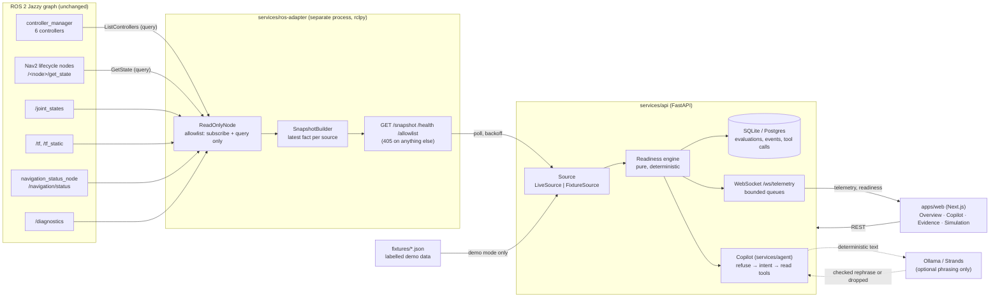
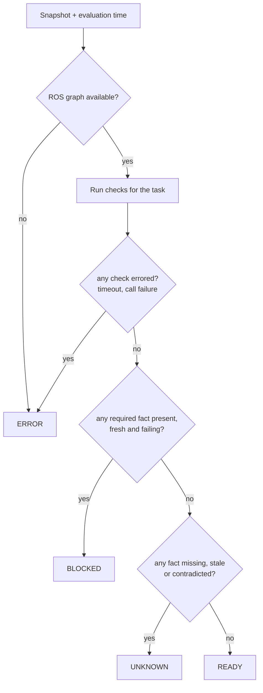
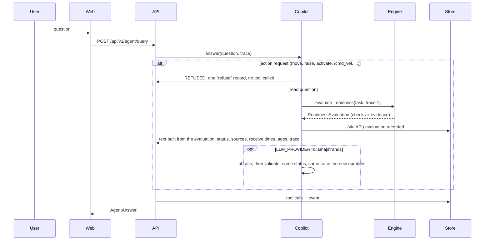

# Architecture

The RFC asks for an agent at the edge of the existing control system. The Studio observes; it never
holds motion authority.

## Components

**Boundaries:**
- The adapter is the only process that imports `rclpy`, and it can only subscribe or call two query service types (`ListControllers` and `GetState`).
- The API changes only its own state: the selected fixture and the evidence it records.
- The LLM is never given a tool and never decides a status.

## Readiness rules

The checks per task:

| Task | Checks |
|---|---|
| `upper_body` | `controller_manager` reachable; each of the 6 controllers `active`; `/joint_states` fresh with all 17 expected joints finite. A controller reported active whose joint is absent is a contradiction, so UNKNOWN. |
| `navigation` | `/navigation/status` fresh, its `navigation_readiness` (reason codes decoded by name) and `health`; Nav2 `get_state` for each managed node when observed. READY on `/navigation/status` while a node is inactive is a contradiction, so both are UNKNOWN. |
| `overall` | The expected subsystems (`STUDIO_SUBSYSTEMS`) plus every `/diagnostics` entry: ERROR blocks, WARN passes with severity warning, STALE is unknown. |

**Freshness:**
- Ages are measured from the adapter's receive time against the per-source budgets in `profile.MAX_AGE_S`.
- A fact received more than 1.5 s "in the future" is stale. This covers the WSL2 clock stepping back about a second.
- Header stamps are reported but not trusted for age, because they are sim time under Gazebo.

## Copilot sequence

## Live failure handling

- **Adapter unreachable:** `LiveSource` marks the connection `reconnecting`, then `disconnected` after 3 failures, and backs off exponentially up to 10 s. The snapshot becomes `graph_available=false`, so readiness is ERROR with the reason. Fixtures are never substituted in live mode, and the fixture endpoints return 409.
- **Malformed snapshot:** schema validation fails, the failure is reported like a connection failure, and no partial data is used.
- **WebSocket:** each subscriber has a bounded queue (256) and drops its oldest message when full, so a slow browser never blocks the loop. The browser keeps at most 300 frames and reconnects with backoff from 0.5 s to 10 s.
- **Web:** if the API is down, the top bar shows "API unreachable", the banner says no data is substituted, and the cards show no values.

## Persistence

- SQLAlchemy Core with portable types and an Alembic migration (`services/api/migrations`), run on start.
- SQLite by default. For Postgres, install `services/api[postgres]` and set `DATABASE_URL=postgresql+psycopg://…`.
- The subsystem filter runs in Python, because JSON containment differs between the two databases.
- **When an evaluation is recorded:**
  - when its status changes;
  - every `RECORD_HEARTBEAT_S` (60 s);
  - when a client asks for one (`GET /readiness`, the copilot).

  Each record stores the full snapshot, so it can be replayed.
